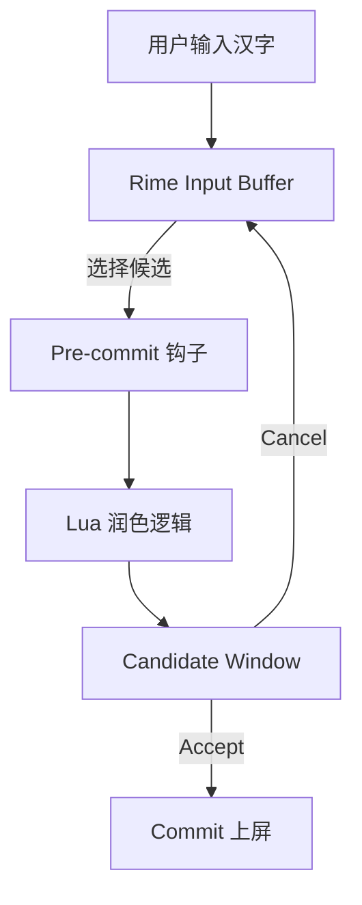
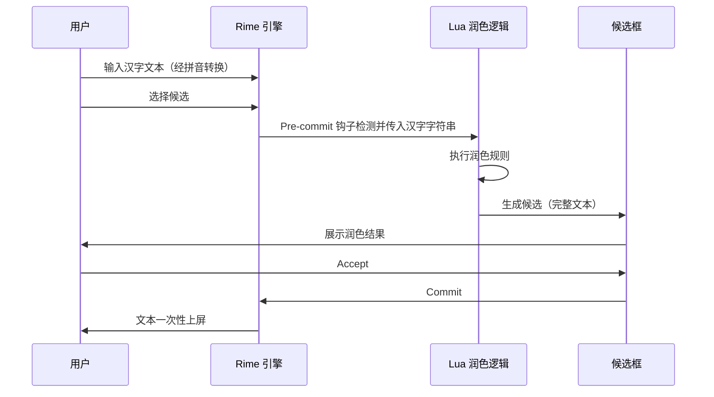

# Rime 长文本润色输入法（MVP）规格说明

## 1. 目标（Goals）

本系统旨在基于 **Windows Rime + Lua**，实现一种“输入法态的长文本润色工具”，其核心目标是：

* 捕获用户输入的**完整长文本**（支持换行，长度不少于 140 字符）
* 在**显式触发**后，对文本进行一次性润色处理
* 通过 **候选框（Candidate Window）** 展示润色结果，作为最小 GUI
* 仅在用户 **Accept** 后，将润色后的完整文本一次性写入目标输入框

本 MVP 以功能可验证为优先，不追求美观或复杂交互。

---

## 2. 非目标（Non-goals）

MVP 阶段明确不包含以下内容：

* 云端或 AI 模型接入
* 多候选对比或选择
* 自定义按钮式 GUI（独立窗口）
* 快捷键设计与优化
* 富文本编辑器或非 textarea 场景适配
* 润色结果的二次编辑

---

## 3. 系统形态与技术约束

* 平台：Windows
* 输入法框架：Rime（Weasel）
* 扩展语言：Lua
* GUI 载体：**Rime 候选框（Candidate Window）**

约束说明：

* 不引入任何外部进程或窗口
* 不使用除候选框之外的 GUI 元素
* 所有逻辑运行于 Rime + Lua 内部能力范围

---

## 4. 核心概念定义

### 4.1 原始输入文本（Raw Input Text）

* 指用户在润色输入模式下输入的完整文本
* 支持任意字符与换行符
* 仅存在于输入法内部状态中
* **在任何情况下都不会直接上屏**

### 4.2 润色结果文本（Polished Text）

* 由原始输入文本经润色逻辑生成
* 在候选阶段作为唯一候选项展示
* 在 Accept 后作为最终上屏内容

---

## 5. 输入与触发模型

### 5.1 输入阶段（Input Phase）

* 系统始终处于润色模式，没有非润色模式的切换
* 用户进入本工具后即开始输入原始文本
* 系统持续接收用户输入字符
* Enter 键用于插入换行符
* 不对输入内容做实时润色或候选生成

### 5.2 显式触发（Explicit Trigger）

* 用户通过某种**显式操作**声明"输入完成，开始润色"
* 触发方式：在 Rime 的 pre-commit 阶段检测条件（如文本长度 ≥140 字符，或用户按特定键组合），不介入 processor 和 translator 阶段（让 Rime 自行处理拼音到汉字转换）

**触发后的语义定义（必须满足）：**

* 当前输入被视为最终原始文本
* 输入状态被冻结，不再接受新字符
* 系统进入润色与候选生成阶段

---

## 6. 润色与候选生成

### 6.1 润色逻辑

* 由 Lua 实现
* 基于确定性规则（如正则、字符串替换等）
* 同步执行
* 纯函数语义：

  `Raw Input Text -> Polished Text`

### 6.2 候选生成规则

* 显式触发后 **仅生成一次候选**
* 候选数量固定为 1
* 候选内容为 **完整润色后的文本**
* 不截断、不摘要

---

## 7. 候选框作为 GUI 的行为约定

* 候选框用于：

  * 展示润色后的完整文本
  * 承载用户 Accept / Cancel 行为
* 候选框不是编辑器：

  * 不支持光标移动
  * 不支持文本修改
* 长文本允许自动换行或被裁剪显示

  * 不保证完整可视
  * 不影响最终 commit 内容

---

## 8. Accept 与上屏语义

### 8.1 Accept 行为

* Accept 是**唯一**触发文本写入目标输入框的时机
* Accept 后：

  * 一次性写入润色后的完整文本
  * 清空内部输入状态

### 8.2 禁止行为

* 原始输入文本在任何阶段直接上屏
* 候选生成时自动 commit
* 润色过程中部分上屏

---

## 9. 取消与异常处理（MVP 最小定义）

### 9.1 用户取消

* 在候选阶段，用户可触发取消操作（使用 Rime 本身的取消机制，如 Esc 键或继续输入）
* 取消后：

  * 不上屏任何文本
  * 清空内部输入状态

### 9.2 润色失败

* 若润色逻辑执行失败：

  * 不生成候选
  * 不上屏任何文本
  * 系统回到初始状态
  * 用户可继续输入或清空

---

## 10. 输入内容生命周期

* 原始输入文本：

  * 仅存在于输入阶段与润色阶段
  * 在 Accept 或 Cancel 后被销毁
* 润色结果文本：

  * 仅在候选阶段存在
  * Accept 后写入目标输入框

---

## 11. MVP 适用范围假设

* 使用场景：网页 textarea
* 不主动区分控件类型
* 假设目标应用能正常接收输入法 commit 行为

---

## 12. 实现说明

触发机制和取消机制均使用 Rime 本身的候选选择与取消机制，无需额外定义。

# 补充 Spec – 基于 Rime + Lua 的汉字润色输入管道

> 本文档定义 **MVP1** 的完整规格。MVP1 明确限定在 **Rime + Lua 内部能力**，不涉及外部 GUI、独立应用或系统级注入。
>
> 核心定位：
> **不是实现一种输入法，而是利用 Rime 的输入拦截、候选展示与上屏机制，实现“汉字 → 汉字”的润色确认管道。**

---

## 1. 目标与非目标

### 1.1 目标（Goals）

* 对用户已输入的 **汉字文本**进行本地润色（规则可写死在 Lua 中）
* 支持一次性处理 **较长文本**（例如 ≥140 字符，包含换行）
* 在 **候选阶段**展示完整润色结果
* 仅在用户 **accept** 后才真正上屏（commit）
* 全程运行在 **Rime + Lua** 内部

### 1.2 非目标（Non-Goals）

* 不实现拼音 → 汉字、五笔 → 汉字等输入法转换逻辑
* 不优化语言模型、词频或联想
* 不支持多候选、多轮润色
* 不引入外部 GUI 或系统级能力

---

## 2. 核心设计原则

1. **汉字 → 汉字**

   * MVP1 只处理已经存在的汉字字符串
   * 不关心这些汉字是如何输入的

2. **显式触发**

   * 不在每次按键时自动润色
   * 仅在明确触发后进入润色流程

3. **候选框即 GUI**

   * 候选框被视为事务确认界面
   * 用于展示完整润色结果并等待 accept

4. **一次性事务**

   * 输入 → 润色 → accept → commit
   * 不支持中途编辑或回滚

---

## 3. 数据模型

### 3.1 输入

* 类型：字符串
* 内容：已存在的汉字文本
* 特性：

  * 可包含换行
  * 长度不设严格上限（以 Rime 实际能力为准）

### 3.2 输出

* 类型：字符串
* 内容：润色后的完整汉字文本
* 候选数量：**1 个（MVP）**

---

## 4. Rime 组件使用说明（关键）

### 4.1 明确不用的组件

| Rime 组件           | MVP1 状态   |
| ----------------- | --------- |
| composer          | 不使用       |
| translator（拼音→汉字） | 不使用（或伪实现） |
| processor         | 不使用       |
| 词库 / 语言模型         | 不使用       |

### 4.2 实际使用的组件

| 组件               | MVP1 中的职责        |
| ---------------- | ---------------- |
| pre-commit 钩子    | 检测触发条件，执行润色逻辑  |
| Lua 逻辑           | 对汉字字符串执行润色规则     |
| candidate window | 展示完整润色结果         |
| commit           | 用户 accept 后一次性上屏 |

> 在 MVP1 中，Rime 的角色是：
> **文本拦截器 + 候选确认机制 + 提交通道**

---

## 5. 组件图（概念）

说明：

* 输入缓冲中已经是汉字（经 Rime 处理）
* 只有在选择候选后，pre-commit 钩子检测条件触发润色
* 候选窗口只展示一个完整结果

---

## 6. 操作时序

### 6.1 正向流程（MVP 唯一关注）

1. 用户在任意文本框中输入一段汉字文本（经 Rime 处理拼音到汉字）
2. 用户选择候选（commit 即将发生）
3. Pre-commit 钩子检测触发条件（如文本长度 ≥140 字符），暂停正常 commit
4. Lua 读取即将 commit 的汉字字符串
5. Lua 执行润色规则，生成润色文本
6. 候选框显示 **完整润色结果（1 个候选）**
7. 用户点击 accept
8. Rime 将润色后的文本一次性 commit 到目标文本框

### 6.2 时序图

---

## 7. 润色逻辑（MVP 约束）

* 实现方式：Lua
* 规则来源：

  * 正则表达式
  * 字符串替换
  * 简单启发式规则
* 不接入云端
* 不做多版本输出

---

## 8. 触发机制

* 触发在 Rime 的 pre-commit 阶段，通过钩子检测条件（如文本长度 ≥140 字符，或用户按特定键组合）
* 不介入 processor 和 translator 阶段，让 Rime 自行处理拼音到汉字转换
* 用户通过选择候选（如按空格或数字键）来触发润色流程
* 这是 Rime 输入法的标准交互方式，无需额外定义

---

## 9. 限制与假设

* 单次、单向流程
* 不处理异常或失败情况
* 不考虑候选框显示截断问题（假设可完整展示）
* 不支持多候选或再次编辑

---

## 10. 总结

在 MVP1 中：

* Rime **不是输入法**
* Lua **不是翻译器**
* 候选框 **不是选词界面**

而是：

> **一个利用输入法框架实现的、全局可用的“汉字文本润色与确认管道”。**

该设计天然为后续独立 GUI 或系统级方案演进提供稳定基线。
