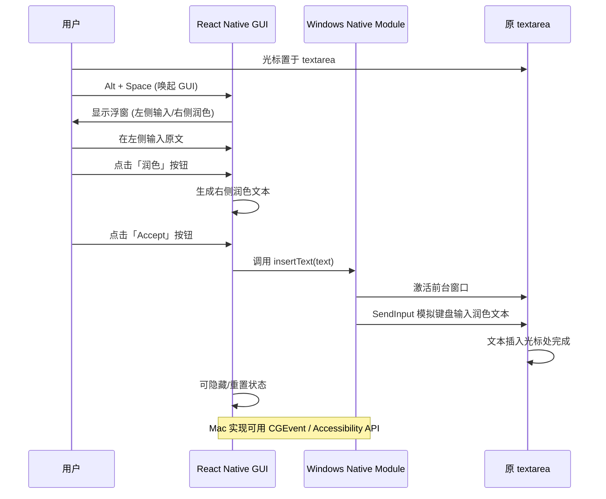

# MVP2 Spec – 浮窗润色输入法 (Windows)

## 1. 目标

实现一个**独立浮窗 GUI**，用于对长文本进行本地润色，并能**将润色后的文本插入到用户之前所在的文本框光标处**。

* 单次、正向流程
* 支持长文本（≥140 字符）
* 支持换行
* MVP2 仅 Windows 实现，GUI 使用 React Native + Expo
* Mac 可在未来通过 CGEvent / Accessibility API 实现，细节不在 MVP2 范围

---

## 2. 全局快捷键

* 快捷键：`Alt + Space`
* 功能：唤起浮窗 GUI
* 前置假设：

  * 用户光标已放在可输入的文本控件（textarea）
  * GUI 唤起后原控件失焦是正常且可接受的

---

## 3. GUI 设计

### 3.1 结构

* 浮窗置顶，可移动
* 左侧输入区（textarea）

  * 用户输入原始文本
* 右侧润色区（只读）

  * 展示润色结果
* 按钮：

  1. **润色**：生成右侧文本
  2. **Accept**：将右侧文本插入原控件

### 3.2 MVP 简化假设

* 不考虑透明度
* 不考虑多轮修改
* 不考虑 UI 美观
* 不考虑快捷键替代按钮操作

---

## 4. 核心逻辑

### 4.1 正向操作流程

1. 用户在网页 textarea 中点击，光标置于目标位置
2. 用户按 `Alt + Space`，浮窗 GUI 显示
3. 用户在左侧输入原文
4. 用户点击「润色」生成右侧文本
5. 用户点击「Accept」触发文本写入

### 4.2 文本写入实现（Windows）

* GUI 调用 **Native Module**：

  ```javascript
  NativeModules.InsertText.insertText(text)
  ```
* Native Module 内部逻辑：

  1. 激活唤起 GUI 前的前台窗口 (`SetForegroundWindow`)
  2. 使用 **Win32 SendInput API**，逐字符模拟键盘输入文本

     * 换行字符使用 Enter
  3. 文本被插入原光标位置

### 4.3 简化假设

* 假设前台窗口可输入
* 不处理多窗口切换或焦点丢失
* 单次单向流
* 不考虑特殊字符或组合键

---

## 5. GUI ↔ Native 模块桥接

| 层级                      | 责任                                          |
| ----------------------- | ------------------------------------------- |
| React Native GUI        | 浮窗显示、按钮、左/右侧 textarea、状态管理                  |
| Native Module (Windows) | 激活前台窗口、SendInput 插入文本                       |
| JS 调用接口                 | `NativeModules.InsertText.insertText(text)` |
| 数据流                     | 左侧输入 → 润色 → Accept → Native 模块 → 前台窗口插入文本   |

---

## 6. 文本长度与换行支持

* 支持一次性输入 ≥140 字符文本
* 支持换行
* SendInput 模拟键盘输入逐字符插入，包括 Enter

---

## 7. 跨平台说明（简洁）

* Mac 可使用类似机制：

  * **CGEvent 或 Accessibility API** 激活前台窗口并插入文本
* MVP2 仅实现 Windows

---

## 8. 限制与简化假设

* 单次、单向流程
* 前台窗口必须可输入
* 不处理错误或失败
* 不处理多窗口 / 多应用场景
* 不考虑快捷键冲突或焦点丢失

---

## 9. 流程时序图


